<picture>
  <source media="(max-width: 600px) and (prefers-color-scheme: dark)" srcset="./assets/header-narrow-dark.svg">
  <source media="(max-width: 600px)" srcset="./assets/header-narrow-light.svg">
  <source media="(prefers-color-scheme: dark)" srcset="./assets/header-wide-dark.svg">
  
</picture>

### About me

I'm a full stack developer and Computer Science student at **PUC Goiás**. I build web applications end to end: responsive interfaces with **Angular, React and TypeScript**, and RESTful APIs with **Java/Spring Boot, .NET and Node.js**. I also work with AI, integrating language models into products and building AI agents.

- **Now:** Software Developer intern at SEAD (Goiás State Department of Administration) since Dec 2024, building Angular front ends, Design System components and Spring Boot APIs, with GitLab CI/CD in a Scrum team.
- **Studying:** Computer Science at PUC Goiás, graduating in Jul 2027.
- **Learning:** AWS and Kubernetes.
- **Languages:** Portuguese (native), English (advanced), Spanish (intermediate).

### Tech stack

<picture>
  <source media="(max-width: 600px) and (prefers-color-scheme: dark)" srcset="./assets/stack-narrow-dark.svg">
  <source media="(max-width: 600px)" srcset="./assets/stack-narrow-light.svg">
  <source media="(prefers-color-scheme: dark)" srcset="./assets/stack-wide-dark.svg">
  
</picture>

### Activity

<picture>
  <source media="(max-width: 600px) and (prefers-color-scheme: dark)" srcset="./assets/activity-narrow-dark.svg">
  <source media="(max-width: 600px)" srcset="./assets/activity-narrow-light.svg">
  <source media="(prefers-color-scheme: dark)" srcset="./assets/activity-wide-dark.svg">
  
</picture>

Refreshed every day by a GitHub Action that reads the GitHub API.

### Let's connect

  
  
  

